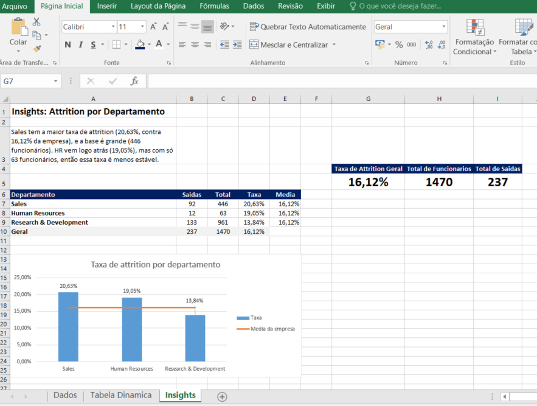

# People Analytics: Turnover & Attrition

## Objetivo
Entender por que os funcionários saem da empresa, usando o dataset IBM HR Analytics (1.470 funcionários). A análise busca responder com base em evidências, e não em suposições, e mostra associações entre a saída e fatores como hora extra, salário, cargo e distância de casa. Pipeline completo em Excel, SQL, Python e Power BI.

## Perguntas de negócio

1. **Qual é a taxa geral de attrition e como ela varia por departamento?** A taxa geral é de 16,12%. Sales tem a maior (20,63%), seguida de Human Resources (19,05%, base pequena, 63 funcionários) e Research & Development (13,84%).
2. **Fazer hora extra aumenta a chance de saída?** Quem faz hora extra tem taxa de saída de 30,53%, contra 10,44% de quem não faz (quase 3 vezes maior). Os dados mostram a associação, mas não provam que a hora extra é a causa.
3. **Existe relação entre satisfação no trabalho e attrition?** Quem saiu tinha satisfação média de 2,47, contra 2,78 de quem ficou, numa escala de 1 a 4. A diferença é pequena.
4. **Funcionários com salário mais baixo saem mais?** Quem saiu ganhava em média 4.787,09 por mês, contra 6.832,74 de quem ficou (cerca de 30% a menos). Por faixa salarial, a taxa de saída é de 28,61% na faixa Baixa (até 3.000), 12,10% na Media e 10,50% na Alta; a maior queda está entre Baixa e Media. O tempo de casa ainda não foi analisado.
5. **Qual cargo tem a maior taxa de rotação?** Sales Representative, com 39,76% (33 de 83 funcionários), seguido de Laboratory Technician (23,94%) e Human Resources (23,08%). A menor é a de Research Director (2,50%). A base de Sales Representative é menor que a de outros cargos.
6. **A distância de casa influencia a decisão de sair?** A taxa sobe junto com a distância: 13,77% (faixa 1-5), 16,11% (6-15) e 20,67% (16-29), cerca de 1,5 vez entre os extremos. É um efeito mais fraco que o da hora extra.

## Dataset
IBM HR Analytics Employee Attrition (Kaggle): 1.470 linhas e 35 colunas, sem valores nulos. Na limpeza, foram removidas 3 colunas sem variação (EmployeeCount, Over18 e StandardHours) e criadas 2 colunas (AttritionFlag e FaixaEtaria), resultando em 1.470 linhas e 34 colunas.

## Etapas do projeto
- [x] Setup do ambiente e versionamento no GitHub
- [x] Análise em Excel (KPIs, tabela dinâmica e dashboard)
- [x] Consultas em SQL (SQLite, com GROUP BY, CASE WHEN e JOIN)
- [x] Limpeza e EDA em Python (pandas e seaborn)
- [ ] Dashboard em Power BI

## Principais insights
- O número bruto de saídas engana: R&D tem o maior número de saídas (133), mas a menor taxa (13,84%). Para comparar grupos, é preciso usar a taxa.
- Hora extra e salário baixo são os dois fatores mais fortemente associados à saída: quase 3 vezes e cerca de 2,7 vezes, respectivamente. A distância de casa tem efeito mais fraco (cerca de 1,5 vez).
- Excel, SQL e Python chegaram aos mesmos números, o que dá confiança nos resultados.
- Todos os resultados mostram associação, e não provam causa.

## Estrutura do repositório
- `data/raw`: dataset original, nunca editado
- `data/processed`: dados limpos (`employees_clean.csv`)
- `excel`: análise e dashboard em Excel
- `sql`: consultas (`queries.sql`) e script da tabela de faixas salariais
- `notebooks`: carregamento do banco, limpeza e EDA
- `docs`: log de progresso (`checkpoints.md`) e prints

## Como reproduzir
1. Clone o repositório.
2. Crie e ative um ambiente virtual e instale as bibliotecas: `pip install pandas matplotlib seaborn ipykernel`
3. Rode `python notebooks/00_carregar_sql.py` para criar o banco `data/processed/hr.db` (ele não é versionado).
4. Rode `sql/01_criar_faixa_salarial.sql` no banco e depois as consultas de `sql/queries.sql`.
5. Abra os notebooks `01_limpeza.ipynb` e `02_eda.ipynb` e use Run All.